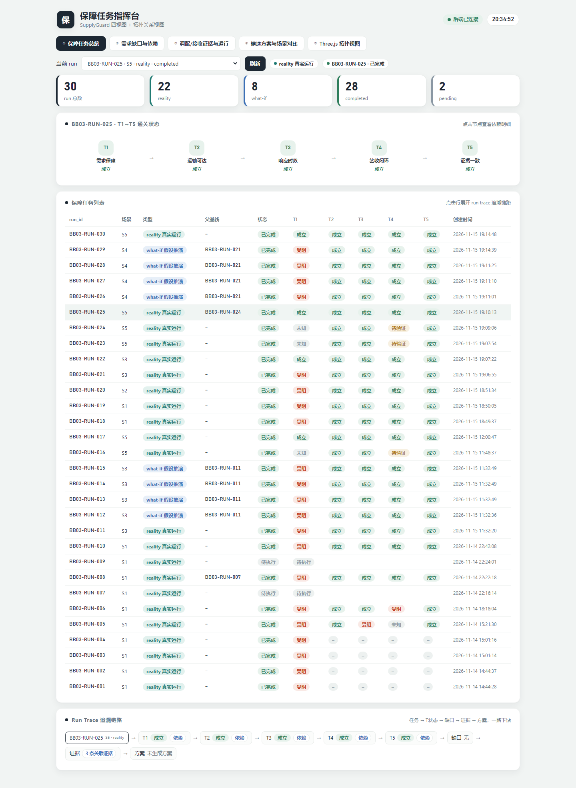

# SupplyGuard 应急物资保障系统 · 校园极端天气演练的「保供值班员」

> 签收取证失败≠未送达：每个服务点保障成不成立



## 1. 它解决什么问题

| 项      | 内容                                                                                                               |
| ------ | ---------------------------------------------------------------------------------------------------------------- |
| 给谁用    | 校园极端天气演练中的保供值班员（保障指挥与签收复核人员）                                                                                     |
| 在什么场景  | 演练或极端天气应急期间，储备点 R1/R2 向教学楼、图书馆、体育馆（P1/P2/P3）投送饮用水、照明、急救包时，值班员打开工作台看全局                                            |
| 解决什么   | 不用它只能看到仓库库存数字，不知道每个关键服务点的保障任务（需求→运输→时效→签收→证据）到底成不成立；用了它每个任务 T1~T5 逐项判定落库，缺口定位到"哪个服务点缺什么"，三套调拨方案可执行性一眼判定，签收复核闭环留痕 |
| 明确不做什么 | 不做真实设备自动控制与自动调度执行；数据来自模拟器与冻结场景文件，不接真实传感器；不做小程序之外的其他移动端；不做多用户权限体系                                                 |

## 2. 核心功能

| 功能                     | 当前状态 | 一句话说明                                                                                                  |
| ---------------------- | ---- | ------------------------------------------------------------------------------------------------------ |
| T1~T5 五级保障判定           | 已实现  | 需求保障/运输可达/响应时效/签收闭环/证据一致性，逐任务独立落库、可追溯                                                                  |
| 缺口识别与候选方案判定            | 已实现  | 双证据齐全且 gap>0 才生成 blocker；固定三套调拨方案（PLAN-A/B/C）逐条规则判定可行性                                                 |
| 接收复核闭环                 | 已实现  | 待复核单 → 签收提交 → 幂等回执 → 自动生成新 run 复测（REST 全链路实测；小程序页面见下一行）                                                |
| 取证失败可信降级               | 已实现  | 证据 unavailable 判 unknown / pending_verification，全链路禁止输出 NOT_RECEIVED                                   |
| reality / what-if 双轨推演 | 已实现  | 假设推演独立落库，父基线六表 sha256 指纹防污染校验                                                                          |
| 统一证据层与辅助证据             | 已实现  | evidence_v2 签收/调配直连证据 + 天气/RAG/ML/工具轨迹/LLM 解释，异常一律降级不阻断判定                                              |
| 场景冻结与现场调整              | 已实现  | S1~S5 冻结基线，现场变量走 input_overrides / assumptions，不改场景文件                                                  |
| 前端工作台                  | 已实现  | 四视图 + Three.js 拓扑 + run trace 下钻，30 秒自动轮询刷新，Three.js 本地化离线可用                                           |
| MQTT 实时链路              | 已实现  | 三类模拟器 → broker → 落库 + WebSocket 推送；broker 不在自动降级、后台重试                                                  |
| 微信小程序（待复核+签收）          | 部分实现 | 两个页面代码完成、后端契约已实测对齐；未在微信开发者工具实机运行（开发机未安装）                                                               |
| 自动化回归体系                | 已实现  | 215 用例全绿：场景 63 + 板块二 16 + 阶段07 79 + 前端 34（配 prepare_frontend_test_data.py 预置数据）+ E2E 克隆验收 15 + 空环境自举 8 |

## 3. 10 分钟快速复现

### 路线 A：完整模式（依赖 MQTT broker 与天气外网）

```bash
# ① 获取代码
git clone https://github.com/yang-shi-man070316/supplyguard.git
cd supplyguard

# ② 安装依赖（国内网络慢时加镜像: -i https://mirrors.aliyun.com/pypi/simple）
pip install -r requirements.txt

# ③ 启动 MQTT broker（完整模式实时链路需要；Windows 服务或 Linux apt/docker 的 mosquitto 均可）

# ④ 启动后端
cd backend
uvicorn main:app --host 0.0.0.0 --port 8000

# ⑤ 另开终端（项目根目录）启动实时模拟器
python simulator/simulator.py --interval 5
```

期望结果：后端终端出现 `Uvicorn running on http://0.0.0.0:8000 (Press CTRL+C to quit)`；浏览器打开 http://127.0.0.1:8000/console/ 看到「保障任务指挥台」，右上角状态「后端已连接」，实时数据随模拟器每 5 秒更新。

### 路线 B：最小可跑模式（无 broker / 无外网 / 无 .env）

```bash
git clone https://github.com/yang-shi-man070316/supplyguard.git
cd supplyguard
pip install -r requirements.txt   # 国内网络慢时加: -i https://mirrors.aliyun.com/pypi/simple
cd backend
uvicorn main:app --port 8000

# 浏览器打开 http://127.0.0.1:8000/console/
# 另开终端（项目根目录）跑场景重放，不依赖任何外部服务：
python scenarios/load_scenario.py S3 --full
```

降级后的能力：场景重放、T1~T5 判定、缺口、方案判定、前端四视图与 run trace 全部可用。启动日志出现明确降级提示 `MQTT broker 不可达 (…), 实时链路暂不可用, 将后台重试`（2026-11-15 实测：无 broker 启动 /health 返回 200、console 页面 200、S3 场景判定完整产出）；console 实时数据区为空（不白屏不报错）；天气证据 status=unavailable；LLM 解释走本地模板。无 .env 也能完整运行（环境变量全部可选）。

> 两条路线的逐步耗时与输出实录：`test/10min-test.md`（2026-11-15 晚 GitHub 真实克隆冷启动，总耗时 4 分 48 秒）。

## 4. 环境与依赖

| 软件            | 要求版本                                                 | 检查命令                 | 实测版本                                 |
| ------------- | ---------------------------------------------------- | -------------------- | ------------------------------------ |
| Python        | ≥3.8（pandas 2.x 与 uvicorn 0.29+ 均要求 3.8+；3.7 及以下不支持） | `python --version`   | 3.8.10                               |
| 浏览器           | Chrome/Edge 近两年版本（console 纯静态 ES6 + WebGL，无构建依赖）     | 打开 console 页面        | headless Chromium（Playwright 内置）实测通过 |
| mosquitto（可选） | ≥2.0，仅完整模式实时链路                                       | `mosquitto -h`       | 2.1.2                                |
| fastapi       | ≥0.110                                               | `pip show fastapi`   | 0.124.4                              |
| uvicorn       | ≥0.29                                                | `pip show uvicorn`   | 0.33.0                               |
| paho-mqtt     | ≥2.0                                                 | `pip show paho-mqtt` | 2.1.0                                |
| pandas        | ≥2.0                                                 | `pip show pandas`    | 2.0.3                                |

依赖清单：requirements.txt，4 个直接依赖，版本下限锁定（未提交 lock 文件）。numpy 由 pandas 传递安装；ML 模块为 numpy 手写逻辑回归，零额外 ML 框架依赖。

## 5. 环境变量

仓库根目录提供 `.env.example`（模板，不含真实密钥；真实 `.env` 已被 .gitignore 排除）。

| 变量名                                                 | 是否必填 | 作用                                             | 不填会怎样                                                   |
| --------------------------------------------------- | ---- | ---------------------------------------------- | ------------------------------------------------------- |
| `SUPPLYGUARD_LLM_URL`                               | 可选   | 远程 LLM 网关地址（OpenAI 兼容）                         | `/api/explain` 走本地模板解释，返回 provider=local-template（实测正常） |
| `SUPPLYGUARD_LLM_API_KEY`                           | 可选   | 网关密钥                                           | 同上                                                      |
| `SUPPLYGUARD_LLM_MODEL`                             | 可选   | 模型名                                            | 默认 gpt-4o-mini                                          |
| `SUPPLYGUARD_LLM_DISABLED`                          | 可选   | `1` 强制禁用 LLM（故障注入/回归用）                         | 正常启用                                                    |
| `SUPPLYGUARD_MQTT_BROKER` / `SUPPLYGUARD_MQTT_PORT` | 模板变量 | 当前代码使用常量 `127.0.0.1:1883`（.env.example 已注明未读取） | 无影响                                                     |
| `SUPPLYGUARD_API_HOST` / `SUPPLYGUARD_API_PORT`     | 模板变量 | 端口由 uvicorn 启动参数控制                             | 无影响                                                     |
| `SUPPLYGUARD_DB_PATH`                               | 模板变量 | 当前代码默认 `backend/bb03.db`                       | 无影响                                                     |

```bash
cp .env.example .env
# 本项目代码不自动加载 .env 文件，编辑后需 export（PowerShell 用 $env:），见 .env.example 头注释
```

## 6. 复现实测记录

| 项    | 内容                                                                                                        |
| ---- | --------------------------------------------------------------------------------------------------------- |
| 测试人  | 本人                                                                                                        |
| 机器   | 12th Gen Intel Core i7-1260P / 32GB 内存 / Windows 11 Home 10.0.22000                                       |
| 是否首次 | 从未安装                                                                                                      |
| 测试日期 | 2026-11-15                                                                                                |
| 总耗时  | GitHub 克隆冷启动实测 4 分 48 秒（clone 2 分 57 秒 + venv 3 秒 + 依赖 23 秒 + 启动与全部验证步骤，详见 `test/10min-test.md`），10 分钟内完成 |

| 步骤       | 命令                                                                | 实测耗时                   | 备注（卡在哪）                               |
| -------- | ----------------------------------------------------------------- | ---------------------- | ------------------------------------- |
| 1. 拉代码   | `git clone https://github.com/yang-shi-man070316/supplyguard.git` | 2 分 57 秒（15MB，含截图）     | 实测网络耗时，评委环境以实际网速为准                    |
| 2. 装依赖   | `pip install -r requirements.txt`                                 | 22.8 秒（阿里云镜像，pip 缓存命中） | 首次无缓存实测 2 分 18 秒；默认 PyPI 源当日超时，国内镜像稳定 |
| 3. 配环境变量 | 跳过                                                                | 0 秒                    | 全部可选，不配也能完整运行                         |
| 4. 初始化数据 | `python scenarios/load_scenario.py S3 --full`                     | 0.15 秒                 | 建 run + T1~T5 + 缺口 + 方案判定一次完成         |
| 5. 启动    | `uvicorn main:app --port 8000`                                    | 2 秒                    | 启动到 banner 出现                         |
| 6. 打开页面  | 浏览器打开 http://127.0.0.1:8000/console/                              | 1 秒                    | 本地静态页面 + 数据接口                         |

## 7. 验收清单（跑起来该看到什么）

- [ ] 服务启动，终端无报错 → 期望看到：`Uvicorn running on http://127.0.0.1:8000 (Press CTRL+C to quit)`
- [ ] 打开首页 → 期望看到：「保障任务指挥台」+ 5 张 KPI 卡 + 右上角「后端已连接」 → `../docs/screenshots/01-overview.png`
- [ ] 核心功能 1（场景判定）→ 操作：`python scenarios/load_scenario.py S3 --full`；期望：T1 受阻、T2~T5 成立、PLAN-A 可执行 → `../docs/screenshots/04-plans-run021.png`
- [ ] 核心功能 2（投送签收闭环）→ 操作：S3 `--overrides` 追加 7 件签收再 `--full`；期望：新 run 流程条五节点全绿、blocker 消失 → `../docs/screenshots/01-overview.png`（RUN-025 全绿示例）
- [ ] 核心功能 3（缺口视图）→ 操作：console 切「需求缺口与依赖」；期望：需求/接收/缺口矩阵 + blockers → `../docs/screenshots/02-gaps-run025.png`
- [ ] 核心功能 4（证据视图）→ 操作：console 切「调配/接收证据与运行」；期望：签收记录与 evidence_v2 证据列表 → `../docs/screenshots/03-evidence-run025.png`
- [ ] 核心功能 5（run trace 下钻）→ 操作：总览页点任务行 → 链路面板 → 点「依赖」；期望：一路下钻到 T1-D1 依赖明细 → `../docs/screenshots/05-trace-run021.png`、`../docs/screenshots/05b-trace-drilldown.png`
- [ ] 核心功能 6（拓扑视图）→ 操作：console 切「Three.js 拓扑视图」，点 P1 节点；期望：储备点/服务点/连线状态色渲染，节点弹 T1-D1 状态 → `../docs/screenshots/06-topology.png`
- [ ] 核心功能 7（取证失败降级）→ 操作：`python scenarios/load_scenario.py S5 --full`；期望：流程条 T1「未知」、T4「待验证」、无 blocker → `../docs/screenshots/08-s5-degrade.png`
- [ ] 异常 / 降级场景 → 操作：不启动 broker 直接启动后端（路线 B）；期望：日志出现「MQTT broker 不可达…将后台重试」，页面正常、场景判定完整
- [ ] 数据留下记录 → 期望：`GET /api/runs` 或 console run 列表出现本次全部 run（新建即落库，历史 run 判定不被修改）

## 8. 排错 FAQ

**Q：console 页面实时数据一直不更新，历史 run 与场景判定都正常**

- 原因：后端 MQTT 连接断线重连后订阅丢失（paho clean session），或模拟器连接被 broker 静默断开
- 解决：重启后端（uvicorn）恢复订阅；重启模拟器进程。代码已修复（mqtt_client 增加 on_connect 重订阅、模拟器补 loop_start），新代码下两者均自动恢复
- AI 定位过程：用 `netstat` 对比连接端口变化发现后端发生过重连；再用独立订阅者确认消息在 broker 上正常流转，把问题隔离到后端订阅侧，最终加 on_connect 重订阅修复

**Q：模拟器进程还在跑，但数据就是进不来**

- 原因：早期三个常驻模拟器 `connect()` 后没有 `loop_start()`，keepalive 超时后 broker 断开，进程仍在空发
- 解决：三个脚本已补 `loop_start()` + 断线自动重连（reconnect_delay 1~30 秒）+ broker 缺失时明确报错退出；老进程需重启一次

**Q：启动第二个 uvicorn 后，实时数据落库翻倍**

- 原因：两个后端实例都订阅同一 MQTT topic，每条消息被落库两次（实测 15 秒窗口 stock 36 行 = 6 条/轮 × 3 轮 × 2 实例）
- 解决：同一数据库只跑一个后端实例；`netstat -ano | findstr 8000` 检查重复监听，停掉多余实例

**Q：`python scenarios/load_scenario.py S4 --whatif A` 报 `no standard assumption 'A'`**

- 原因：标准推演取值为 `whatif-A / whatif-B / whatif-C`
- 解决：用 `--whatif whatif-A`，或直接传 JSON 假设（`--whatif '{"transport.V2.availability":"AVAILABLE"}'`，实测有效）

**Q：git-bash 里 curl 提交含中文的 JSON 报 400 `There was an error parsing the body`**

- 原因：git-bash 将中文按 GBK 编码发出，JSON 不是合法 UTF-8
- 解决：演示命令用 ASCII 文本，或 `--data-binary @file.json` 传 UTF-8 文件

**Q：8000 端口起不来，报 Address already in use**

- 原因：已有实例在跑（本机开发时常见：后端、模拟器、uvicorn reload 子进程混在一起）
- 解决：`netstat -ano | findstr 8000` 找到 PID 停掉旧实例，或换端口 `--port 8010`（console 按地址访问）

**Q：`python board1_frontend_test.py` 报 Timeout 找不到 `BB03-RUN-007`**

- 原因：前端用例硬编码固定 run 序列（RUN-007 pending / RUN-009~010 / RUN-011 / RUN-016），当前库的 run 序列对不上
- 解决：从干净库（`backend/bb03.db` 无任何 run）开始，先跑 `python prepare_frontend_test_data.py http://127.0.0.1:8000` 生成 RUN-001~016，再跑前端测试（详见 delivery/README.md 第 6 节）

## 9. AI 协同说明

| 项     | 内容                                                                                                               |
| ----- | ---------------------------------------------------------------------------------------------------------------- |
| 使用的工具 | Claude Code                                                                                                      |
| 怎么用的  | 由我说明任务与验收标准，AI 生成代码与测试脚本初版，我审查并逐处修正；本 README 的全部数字与命令由实测产生（AI 执行实测、我复核确认）                                        |
| 对话记录  | 阶段对话导出见 `docs/my_ai_backup/`，存档规范见 `docs/ai-sessions/README.md`；整理后的快照见提交包 `02_AI对话快照/`，覆盖阶段 01~08 共 47 个提交的功能迭代 |
| 人工把关  | 判定语义（T1 口径、降级规则、缺口双证据规则）由我拍板；涉及状态写入的代码（判定落库、复核事务）逐处人工审查；红线约束：场景文件冻结不改、历史 run 只读、证据异常一律降级不阻断判定                    |

## 10. 目录结构

```text
supplyguard/
├── backend/          # FastAPI 后端：判定/存储/接口/回归测试（bb03.db 落库于此）
├── scenarios/        # S1~S5 冻结场景 + load_scenario.py 加载器
├── frontend/         # console.html 四视图+拓扑工作台（vendor/ 本地 Three.js）
├── simulator/        # MQTT 模拟器（综合 simulator.py + 三个常驻模拟器）
├── miniprogram/      # 微信小程序（待复核列表 + 签收提交两页面）
├── analysis/         # 辅助证据：天气 / RAG / ML / LLM 解释 / 报告
├── rag_docs/         # 保障知识库文档（RAG 检索源，3 篇）
├── delivery/         # 交付文档、演示脚本与回归清单
├── docs/             # 截图、测试记录、AI 对话存档
├── test/             # 参赛 README、10 分钟实测记录与验收脚本
└── requirements.txt  # 依赖清单（4 个直接依赖）
```

## 11. 已知限制

| 限制                                                                            | 影响                         | 后续打算        |
| ----------------------------------------------------------------------------- | -------------------------- | ----------- |
| 数据来自模拟器与冻结场景，非真实传感器                                                           | 结论为演练语义下的系统级验证，不代表真实环境运行结论 | 不会补（教学演练定位） |
| 缺口/候选方案/方案判定由 CLI（load_scenario.py）驱动；`POST /api/runs/{id}/execute` 只执行 T1~T5 | REST 侧不能一键触发完整流水线          | 后续可补        |
| 微信小程序未在微信开发者工具实机运行                                                            | 小程序为「代码 + 后端契约实测」状态        | 安装开发者工具后可补验 |
| MQTT 模拟器未生成 dispatch/receipt 消息                                               | 签收闭环走复核 API，不走 MQTT        | 后续可扩展       |
| 单机 SQLite 存储                                                                  | 无多用户并发与多机部署能力              | 不会补（单机演示定位） |
| 历史 run 判定不可修改（只增不改）                                                           | 判定错误只能新建 run 复测，不能回改       | 设计使然（追溯可信）  |

---

## 交稿前自检（打勾后删除本节）

- [x] 
  1. 全文无尖括号占位（本项目名/路径/命令均为真实内容）
- [x] 
  2. 无"大概/可能/应该/约"（全部为 2026-11-15 实测值；未测得的如实写"未验证"）
- [x] 
  3. bash 命令已逐条实测（路线 A/B、场景命令、复核 curl 均本机跑通；GitHub 克隆 + 全新 venv 冷启动实测见 `test/10min-test.md`）
- [x] 
  4. 路线 B 实测：不启动 broker、无 .env，后端启动成功并输出降级提示（2026-11-15）
- [ ] 
  5. 全新电脑复现：未验证（无第二台机器）；已有 GitHub 克隆 + 全新 venv 同机冷启动（4 分 48 秒）与 e2e_clone_test.py（15/15）替代验证
- [x] 
  6. 第 7 节每条验收项对应截图真实存在于 `docs/screenshots/`（8 张）
- [x] 
  7. `.env.example` 已放仓库根目录（2026-11-15 从 delivery/ 复制）
- [x] 
  8. 首屏截图放 README 开头
- [ ] 
  9. AI 对话材料待补齐：提交包 `02_AI对话快照/` 与 `01_Git提交日志/` 当前为空，需从 `docs/my_ai_backup/` 与 Claude Code 会话导出整理后放入
- [ ] 
  10. 手机 4G 打开仓库页面验证图片加载：未验证（交稿前待做）
